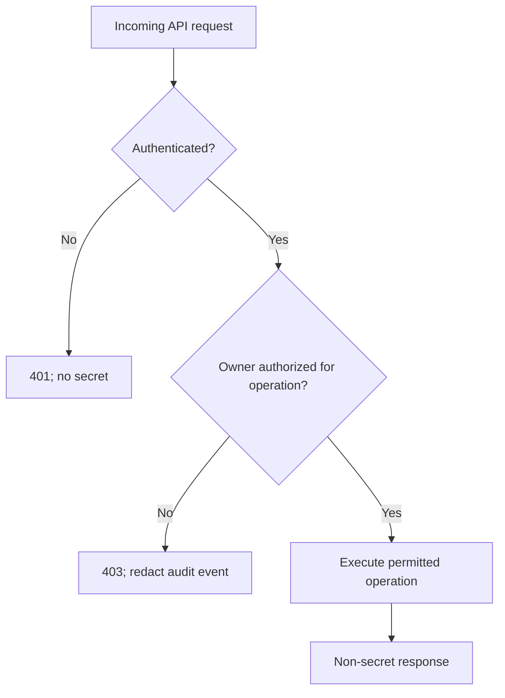

# WP-01 — API Security & Credential Protection

**Status:** DRAFT FOR REVIEW — NOT APPROVED FOR EXECUTION  
**Baseline:** [PR #611](https://github.com/timjardenross/TJRHQ/pull/611) (`014ba427a`)  
**Evidence:** [PR #610](https://github.com/timjardenross/TJRHQ/pull/610) (`e61abcffc5b01cf9875697e27acd3e907d7a21d8`)

## Background

The four-agent investigation reported unauthenticated disclosure of a Command Centre API key, query-string credential acceptance, Infisical machine credentials in process arguments and a Redis credential disclosed during diagnostics. Firewall restrictions reduce external exposure of the key-disclosure endpoint but do not enforce authorization for local callers. This document proposes future remediation without authorizing it.

## Findings and confidence

| ID | Finding | Confidence | Priority |
|---|---|---|---|
| WP01-01 | `app.js:81,106–108`: `/api/config` is auth-exempt and returns API key with `/api/v1` write capability | VERIFIED in reported code review | Critical |
| WP01-02 | `app.js:88`: API key accepted via query parameter | VERIFIED in reported code review | High |
| WP01-03 | `lib-infisical.sh:60–62`: client secret passed as process argument | VERIFIED in reported code review | High |
| WP01-04 | SEC-DR-01: Redis password exposed in diagnostic output | VERIFIED recorded event | High |
| WP01-05 | SEC-DR-02: Coolify `.env` copies mode 0644 under directory mode 0700 | VERIFIED recorded permissions | Context-dependent |
| WP01-06 | Independent custody of Infisical/recovery secrets | UNKNOWN | High dependency |

**Existing future-action references:** FA-01 (key disclosure), FA-18 (credential custody), FA-19 (Redis credential response), as reported. Validate the full mapping against PR #610 before publishing; do not invent action IDs.

## Requirements (MoSCoW)

### Must
- Never return reusable API credentials to unauthenticated clients.
- Require authenticated, owner-authorized server-side checks for every mutation.
- Remove URL-query credential acceptance after legitimate callers are migrated.
- Keep credentials out of process arguments, logs, responses and PR evidence.
- Preserve legitimate owner access and provide tested rollback and negative authorization tests.
- Require explicit owner approval for any credential rotation or production action.

### Should
- Inventory consumers, scopes, storage and recovery dependencies without reading credential values.
- Record access-denied events without sensitive payloads.
- Minimize scope and lifetime of privileged credentials.

### Could
- Introduce narrower service credentials where the current application supports them.

### Won't
- Replace the identity platform wholesale or redesign deployment governance (WP-02).
- Execute changes as part of this documentation task.

## Proposed method

### API boundary

**Target contract, subject to validation against real callers:**

- `GET /api/config`: non-secret UI configuration only; no API key or token.
- Authenticated identity/session endpoint, **only if required by existing architecture**: non-secret identity and capability information.
- `/api/v1` mutation routes: validate identity and operation-specific owner permission server-side.
- Return `401` for missing/invalid authentication and `403` for insufficient authorization.
- Reject API keys supplied via URL query parameters after migration.
- Do not treat localhost, firewall rules or Caddy alone as authorization.

### Secret handling

- Enumerate clients using `/api/config`, `/api/v1` and query-string keys before choosing the replacement flow.
- Use an existing supported header/session mechanism, with application-level authorization.
- For Infisical, verify the **installed CLI version and official supported secret-input mechanisms** before choosing a non-argv approach. Do not invent flags.
- Maintain a **metadata-only** inventory: credential purpose, consumer, scope, storage location class, rotation dependencies and recovery custodian. Never capture values, hashes, environment dumps or token fragments.
- Treat Redis credential validity as UNKNOWN until an owner-approved non-disclosing check. Any rotation requires separate approval, coordinated client updates and rollback.
- Assess historical logs and encrypted backups as possible locations of previously exposed credentials, without accessing or publishing values.

## Proposed implementation stages — NOT AUTHORIZED

| Stage | Deliverable | Gate |
|---|---|---|
| A | Read-only caller inventory and auth-flow map | Scope confirmed |
| B | Detailed API contract and migration design | Owner design approval |
| C | Isolated code changes and unit/integration tests | Separate implementation approval |
| D | Secret transport changes | Supported CLI/API confirmed |
| E | Redis incident disposition and rotation plan | Separate owner decision |
| F | Controlled deployment and monitoring | Explicit production approval |
| G | Redacted acceptance evidence | Independent review |

## Acceptance criteria

1. Anonymous `/api/config` never returns reusable credentials.
2. Anonymous, invalid-credential and non-owner mutation attempts fail across all supported entry points.
3. Legitimate owner and service clients continue to work.
4. URL query-string API keys are rejected after migration; request logs contain no credentials.
5. Infisical secret is absent from process arguments in controlled testing.
6. Source diffs, CI output, test fixtures and diagnostic logs contain no credential values.
7. Redis exposure disposition and recovery credential custody are explicitly recorded, with UNKNOWN preserved until verified.
8. Rollback does not silently reinstate unauthenticated key disclosure.
9. Relevant CI and controlled verification pass before production acceptance.

## Dependencies and risks

- **WP-02:** owner identity, role checks, Supabase service-role boundary, LCARS and messaging authorization.
- **WP-03:** reliable alerting without logging secrets.
- **WP-04:** recovery custody and consequences of credential rotation.
- **Compatibility:** removing `/api/config` key before migrating consumers could break authorized clients.
- **Live exposure:** external reachability is constrained by reported firewall state, not independently reverified here.

## Owner decisions still open

1. Which legitimate clients depend on the existing key bootstrap, and what replacement authentication design should they use?
2. Should a separately authorized credential-response plan be prepared for Redis and any other affected secrets?

**No production changes, credential inspection/rotation, deployments, backup/restore, merges or service restarts are authorized by this plan.**

## PR publication checklist

- [ ] Confirm exact source permalinks and FA mapping against PR #610.
- [ ] Check document for sensitive values.
- [ ] Submit only `README.md` and this WP-01 file in a new documentation PR.
- [ ] Record CI and independent Mac/VM access status.
- [ ] Leave PR unmerged pending explicit owner approval.
