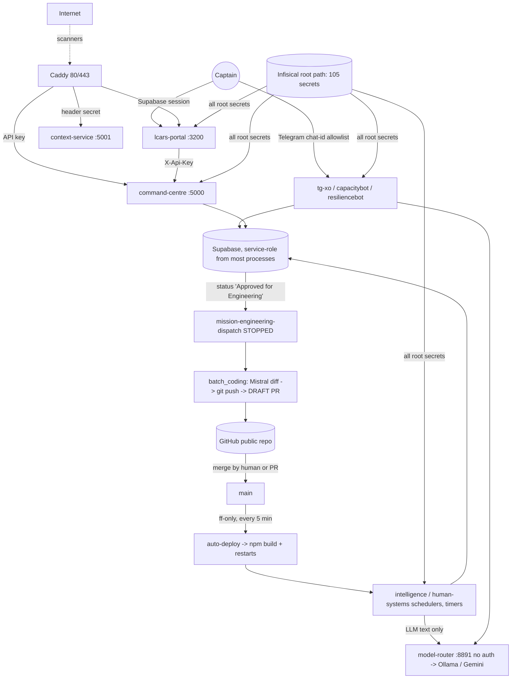

# TJRHQ AI Agent & Automation Ecosystem — Read-only Audit

Date: 2026-11-06 · Host: single Ubuntu 24.04 VM · Repo `main` @ `8838dfc`
Method: static inspection by four parallel read-only code reviewers (Telegram bots; mission orchestration; scheduled jobs/workers; model integrations/credentials) plus my own direct metadata checks (`systemctl`, `ss`, journal counts, file metadata, status-code probes). No repo code executed, no services touched, no model/Telegram/webhook calls, no `.env`/`.infisical-auth.env` opened, no secret values printed (env var NAMES only).

Labels: **[V]** verified by me directly · **[R]** reported by a reviewer from code reading, not re-checked · **[P]** potential risk · **[U]** unknown.
Disclosure: earlier in this session `pm2 list` auto-spawned an empty PM2 daemon (no managed processes); I left it alone.

> **Correction (2026-11-06, later the same day):** an earlier version of this report described the self-improvement dashboard's approval endpoints as reachable only from localhost. That was wrong. Follow-up verification found the dashboard is **also reachable beyond localhost through the reverse proxy**, and its handlers contain no authentication. This is re-rated **Critical** (rank 1 in section H). Exact paths and endpoint names are withheld from this public document until the exposure is fixed; the Captain has the full details.

---

## A. Executive summary

1. **There is no autonomous "Commander" agent.** No LLM chooses tools or shell commands anywhere in the Telegram bots, schedulers or model integrations [V: no `shell=True`/`eval`/`os.system` in `telegram-bots/`; R: same across model code]. The old action-capable XO bot (full host shell, plan-then-approve) was retired 2026-07-05 [V: `tg-xo.service` header]. **Earlier notes describing XO as a shell-capable bot are stale.**
2. LLM output reaches the outside world through three paths: text replies/briefs; DB writes by deterministic code after LLM classification (capture-enrichment); and **model-written code diffs pushed to GitHub as draft PRs** (engineering batch coding). That last path is the only place model output can become code.
3. **The human approval model is thin.** Gating relies on (a) one Telegram chat-id allowlist, (b) a mission *status string* ("Approved for Engineering") that any API-key holder or portal user can set, and (c) approve endpoints on the self-improvement dashboard that have no authentication and are reachable beyond localhost (see the correction above). No transition machine is enforced; the one that exists is unwired.
4. **Credential isolation is the biggest structural weakness.** Both Infisical wrappers export the project root path, so **every service receives all 105 root secrets** [V: `run-with-infisical-bot.sh` sources `/` then `/bots/<name>`; non-bot wrapper uses `infisical run`, which injected 105 secrets when I ran it]. Nearly everything runs as root, with no sandboxing or resource limits.
5. **Reliability is decent day to day** (all timers succeeding, `NRestarts=0`, nightly encrypted backup OK) but has gaps: no leases/heartbeats for missions, check-then-act races, non-atomic ID counter write, hung oneshots never time out, alerts on only 5 units, ~17 scheduler restarts/day from auto-deploy.
6. **Corrections to reviewer severity (verified):** the reviewer's "Critical: approval bypass → root coder" assumed a live path. The engineering-dispatch timer has been **stopped since 2026-10-28** [V], `/api/config` is not reachable from outside [V, earlier audit], and `CONTEXT_SERVICE_SECRET` is set [V], so the "fails open" condition is not active. I re-rated these (see H).

---

## B. Agent and service inventory

### B1. Interactive agents (Telegram, long polling, all root, no sandbox)
| Unit | Purpose | Capabilities [R unless noted] | Secrets scope |
|---|---|---|---|
| `tg-xo` (`telegram-bots/xo/app.py`) | Captain companion: LLM chat, briefs, voice capture, follow-through, `/revs_generate`, `/restart_bots`, `/merge_pr`, `/decline_pr` | list-argv subprocesses only (systemctl restart tg-xo, intelligence.scheduler --once, advisory CLI, REVS pipeline, whisper); GitHub merge/close; Supabase (scoped `xo_bot` role, silent fallback to service-role); messages only the allowed chat | all root secrets + `/bots/xo` |
| `tg-capacitybot` | Capacity check-ins, experiments | no subprocess/LLM/GitHub; Supabase **service-role** unconditionally | all root + `/bots/capacitybot` |
| `tg-resiliencebot` | Resilience crosswalk (LLM, accept/edit/reject) | no subprocess/Supabase; appends `audit.jsonl` | all root + `/bots/resiliencebot` |

### B2. Daemons / workers
| Unit | Purpose | Wrapper | Notes |
|---|---|---|---|
| `intelligence-scheduler` | 27-job APScheduler: briefs, OSINT, emergency alerts, Telegram | `flock` + bot-xo | 120 starts in 7 days [V] |
| `human-systems-scheduler` | proactive pushes via pgqueuer (`SKIP LOCKED`) | bot-capacitybot | `HS_DISABLED_JOBS` drop-in |
| `command-bus` | 5-min rule/alert poller (does **not** execute missions) | bot-xo | stuck-job rule watches a status nothing writes |
| `context-service`, `model-router`, `mint-server`, `self-improvement-dashboard`, `chatterbox-tts`, `number-one-exporter`, webhook receivers (8765/8766), `phoenix` | support services | mixed | see D/E |
| `command-centre` (Node :5000) | API gateway to Supabase (service-role) | none (dotenv) | shared API key |
| `lcars-portal` (Next.js :3200) | Captain UI, Supabase session auth | plain wrapper | only unit with `ProtectSystem`/`NoNewPrivileges` |

### B3. Timers (all succeeding at audit time [R, status 0])
Autonomous: `auto-deploy` (5 min, user `deploy`), `delivery-reconciler` (15 min, `apply`, writes mission status), `engineering-batch-sync` (30 min, Mistral → draft PRs), `capture-enrichment` (15 min, LLM classification → DB), `vm-processing*`, `verification-engine` (5 min), `deadmans-switch`, `self-improving-system` (daily), `hq-evolution` (nightly, proposal-only), `daily-ops-cycle`, `memory-nightly-consolidation`, `health-*`, `mission-registry-sync` (additive only), `starship-backup`.
**Stopped:** `mission-engineering-dispatch.timer` — enabled, inactive since 2026-10-28 20:57 [V]; it re-arms at next boot.
Units with **no** Infisical wrapper (secrets from on-disk `.env`, mode 620 `root:deploy`): `hq-evolution`, `delivery-reconciler`, `memory-nightly-consolidation`, `health-intelligence-weekly`, `command-centre`, `phoenix`, `mission-engineering-dispatch` [R].

---

## C. Architecture and trust boundaries

Trust boundaries: Internet→Caddy · Telegram→bots (chat id only) · Portal user→Supabase RLS · Portal→backend (shared key) · untrusted text (RSS/OSINT, Telegram, DB rows) → LLM prompts · LLM → draft PR → public GitHub → `main` → auto-deploy → root services.

---

## D. Mission lifecycle and execution model [R, spot-checked where marked]

- **Source of truth:** Supabase `missions`. Copies: `Missions/*.md`, `mission-index.txt` (additive-only sync; statuses freeze), LCARS append.
- **State machine:** only a DB `CHECK` of 14 status values [R]. Any writer can set any status: Slack `/mission-status`, backend `PATCH /api/v1/missions/:id/status`, portal `POST /api/missions` (can create directly at "Approved for Engineering"). `validate_transition`/`_ALLOWED` in `platform-runtime/lib/delivery/lifecycle.py` has no non-test caller. 5+ status vocabularies diverge (`core/coordination/lifecycle_status_map.py` documents it).
- **Execution:** `core/engineering/mission_dispatch.py` (15-min timer, **currently stopped** [V]) picks missions at "Approved for Engineering", writes a handoff, runs `batch_coding sync-one` (Mistral → `git push --force-with-lease` to a deterministic branch → **draft** PR only; never commits to main). `engineering-batch-sync` (30 min) does the same for APPROVED handoffs. `edo_execute.py` "approval" is a CLI flag and its downstream workflow does not exist; `execution_engine.py` is documented dead code.
- **Completion/cancel:** `delivery-reconciler apply` (15 min) overwrites mission status to Closed/Implemented from PR state with no status guard and no transition record.
- **Recovery:** dispatch `MAX_DISPATCH_ATTEMPTS=3`, flat 15-min cadence, local JSONL idempotency record written *after* the subprocess returns (crash ⇒ re-dispatch; same branch + `--force-with-lease` + existing-PR lookup limit duplicates). No leases/heartbeats; only a 7-day "stagnant" notification surfaces stuck missions.
- **IDs:** one canonical minter with `flock`; **counter file written non-atomically** (`id_registry.py:225` `write_text`, [V]) so a truncated file reloads as seed 143 and the drift guard then refuses to auto-bump; sentinel timestamp IDs bypass the counter; `capture.js` `promote-mission` mints its own IDs and is not idempotent.

---

## E. Security findings

| # | Finding | Evidence | Label |
|---|---|---|---|
| E1 | Every service receives all root Infisical secrets (service-role key, GitHub token, model keys, Telegram tokens); capacitybot/resiliencebot/schedulers over-privileged; every subprocess inherits full env | `platform-runtime/run-with-infisical-bot.sh` (sources `/` then `/bots/$BOT`); `run-with-infisical.sh:58-62` `infisical run`; 105 secrets injected | V |
| E2 | Nearly all units run as root, no sandbox/limits (only `lcars-portal`, partly `starship-backup`) | unit files; `systemctl show` | R |
| E3 | **Diff-mode draft PRs have no path fence**: model/poisoned-mission diff can alter `.github/workflows`, `deploy/*.service`, `auto-deploy.sh` on a pushed branch. Fence (`.github/`, `.env`, `secret`, `credential`) applies only to whole-file mode | `core/engineering/batch_coding.py:296-310, 484, 544-565`; `providers/github_pr.py:162-230` | R |
| E4 | **auto-deploy trust model:** `git merge --ff-only origin/main` every 5 min, then `npm ci`/`npm run build` under the full secret set and service restarts; no signature/CI verification in the script. Mitigation: `main` is protected (checks required, [V] blocked merge on #593); exact rules not readable (PAT lacks admin scope) | `deploy/auto-deploy.sh:233-241, 325`; `gh api` `protected:true` | V / U |
| E5 | `/merge_pr` review verdict is **spoofable on a public repo**: last comment containing the marker wins, no author check; no confirmation step beyond a typed `anyway` | `core/engineering/providers/github_pr.py:435-471` | V |
| E6 | Telegram authorization is chat-id only (no user-id/forward checks); safe only if allowed chat is private | `core/platform/telegram_access.py`; bot global gates | R/U |
| E7 | `model-router` (127.0.0.1:8891): no auth, no body cap, no rate limit, CORS `*`, unbounded threads | `core/model-router/app.py` (no auth matches [V]) | V |
| E8 | `context-service` public via Caddy; header-secret check fails open if secret unset (currently **set** [V]); non-constant-time compare; CORS all | `core/context-assembly/context_service.py:323-333` | V |
| E9 | **Critical (corrected).** Self-improvement dashboard approve handlers have no authentication in code, and the dashboard is reachable beyond localhost via the reverse proxy (the proxy configuration's comment claims a header-secret check that the application does not perform). Approval is the gate for direct commits to the `self-improvement` branch and for draft-PR handoffs. Read access was confirmed; write access is inferred and was not tested. | `scripts/self_improvement/dashboard.py` (approve handlers; no auth hook anywhere in the module) | V (no auth, read exposure) / I (write exposure) |
| E10 | Backend `intel-governance` trusts a caller-supplied `role`; shared API key maps to service-role writes | `core/command-centre/backend/api/intel-governance.js:51-57` | V |
| E11 | Unguarded direct-cloud LLM paths bypass PII guardrails (Gemini fallback in `platform-runtime/llm.py`, XO cloud-first with mission/health context, portal routes); Gemini key placed in URL query strings | `platform-runtime/llm.py:416-455` | R |
| E12 | `DeleteFileStrategy` builds `repo_root / path` with no confinement (gated by human approval + suffix check) | `scripts/self_improvement/auto_remediation.py:31-72` | R |
| E13 | Token log redaction is **dead code** (`install_token_redaction()` never called); raw exceptions echoed to Telegram | `telegram-bots/log_redaction.py:80` [V] | V |
| E14 | Portal `/api/ai/chat` takes client-chosen model, system prompt, messages with no token/size cap (authenticated users) | `lcars-portal/src/app/api/ai/chat/route.ts:192` | R |
| E15 | `.claude/settings.local.json`: `autoMode.allow` includes creating/editing systemd units and daemon-reload/enable/start/restart; PostToolUse/UserPromptSubmit hooks forward activity to a local MCP | file structure [V] | V |
| E16 | Prompt-injection: untrusted RSS/OSINT, captures, Telegram text, DB mission rows and recalled memory enter prompts without untrusted-data delimiters; no tool-choosing LLM, so impact bounded to briefs/messages **except** poisoned mission/handoff → diff PR (E3) | `intelligence/brief/llm_provider.py`; `batch_coding.py` | R |

Approval-gate summary: no plan-then-approve exists. Confirm gates present: `/revs_generate` (in-memory token, no expiry/user binding), dashboard click (unauthenticated), draft-only PRs + human merge. Bypass routes: set mission status via API/portal; spoofed verdict comment; localhost POST to dashboard.

---

## F. Reliability and concurrency findings

- **Good:** pgqueuer `FOR UPDATE SKIP LOCKED` (human-systems), `flock` on intelligence-scheduler, ID minting, backup, hq-evolution; `tasks.idempotency_key` UNIQUE; Infisical wrapper fails closed; dispatch retry bound; DB-backed Firecrawl/Bright Data caps.
- **Races (no compare-and-set):** `delivery_reconciler` status overwrite; `escalation_manager` read-modify-write (`count+1`) and resolved rows never reopened; backend status PATCH; Slack status path.
- **Dispatch not crash-safe** (record written after subprocess; plain JSONL, unlocked). **Batch-coding lock gap:** `run_sync.sh` flock not shared with the systemd unit → duplicate PR possible.
- **No leases/heartbeats** for missions; `command-bus` `executor_stuck` watches `engineering_running`, which nothing writes.
- **APScheduler** constructed bare (defaults, ~1 s misfire grace) while auto-deploy restarts services whenever *any* repo commit is newer than service start → **120 starts/7 days** [V]; cron jobs firing during a restart are silently dropped.
- **Hung oneshots** (`TimeoutStartSec=infinity`) block their own timer forever (vm-processing, capture-enrichment, engineering-batch-sync, …). `OnFailure=` alerts exist on only 5 units [V: auto-deploy, self-improving-system, sync-self-improvement-state, daily-ops-cycle, starship-backup]; vm-processing-healthcheck alert is commented out.
- **capture-enrichment** strands items in `queued`/`failed` (no re-queue). **human-systems-scheduler** has no retry/catch-up.
- **Audit tables "append-only" by comment only**; no triggers/RLS block UPDATE/DELETE; retention jobs delete rows; service-role bypasses RLS. `mission_state_transitions` defined twice with different columns (0023 vs 0124); the Command Centre status route may target a wrong key column and swallows transition-write failures [P, needs live schema].
- **Single points of failure:** one VM running everything as root; one shared API key; local ID counter + JSONL files; Infisical container; direct Postgres DSN for pgqueuer.
- **Backup:** nightly restic to Google Drive, encrypted, 27 OKs/30 days [R]; gaps: `/opt/starship/inbox`, Ollama models, Neo4j/Graphiti/Meilisearch/Phoenix/Uptime Kuma data, `command_bus.db`; no scheduled `restic check`/restore test; restic password location off-box [U].

---

## G. Operational and cost-control findings

- No per-day token/dollar cap anywhere reviewed; only per-call `max_tokens` (mostly 2048–4096), timeouts (25–600 s) and per-cycle counts (HQ Evolution caps; `--limit 20`; `MAX_DISPATCH_ATTEMPTS=3`). Gemini calls in `model-router` set no `maxOutputTokens`. `engineering-batch-sync` has no per-run limit.
- Router → Gemini → Ollama fallback chain can silently escalate to paid cloud when the router fails.
- Provider code duplicated ~8 ways (Gemini) / ~6 ways (Mistral) / several Ollama Cloud callers; `gemini-3.5-flash-lite` hard-coded ~60 times; floating alias `gemini-flash-latest`; Ollama default misconfiguration has recurred 3 times.
- Logs: journald pegged at its 1 GB cap; several jobs log to unrotated files under `outputs/` (largest `verification_engine.log` ≈ 27 MB); `command-bus` and `delivery-reconciler` have no `SyslogIdentifier`.
- Observability: per-action attribution exists but is scattered (`mission_state_transitions`, `mission_execution_events`, `authority_audit_log`, JSONL/files); no per-command audit for Telegram `/merge_pr`, `/decline_pr`, `/restart_bots` with user id and outcome; heartbeats are throttled to ~20 min.

---

## H. Severity-ranked risk register

| Rank | Sev | Risk | Notes |
|---|---|---|---|
| 1 | High | All services hold all root secrets, run as root, unsandboxed (E1, E2) | single compromise = full compromise |
| 2 | High | Model diff → pushed branch with no path fence on a public repo; main → auto-deploy runs builds under full secrets (E3, E4) | needs workflow trigger/token-scope review [U] |
| 3 | High (latent) | Mission status is an unenforced string; API key or portal user can mark "Approved for Engineering"; dispatch timer re-arms at boot (D) | currently dormant since 2026-10-28 [V]; downgraded from reviewer's "Critical" |
| 1a | **Critical** | Dashboard approve endpoints unauthenticated and reachable beyond localhost; internal findings readable (E9) | supersedes the earlier "localhost-only" rating; fix before anything else |
| 4 | High | Unauthenticated model-router (E7) | any local process / DNS-rebinding page |
| 5 | Medium | Spoofable `/merge_pr` verdict, chat-id-only Telegram auth, no audit of privileged commands (E5, E6) | |
| 6 | Medium | Race conditions & no leases; non-atomic ID counter; reconciler overwrite (F) | duplicate IDs possible |
| 7 | Medium | Cron jobs dropped across ~17 restarts/day; hung oneshots; sparse OnFailure alerting (F) | silent staleness |
| 8 | Medium | No LLM spend cap; unguarded cloud paths with Captain health/mission context (E11, G) | |
| 9 | Medium | Audit tables not append-only; retention deletes them (F) | |
| 10 | Medium | Backup coverage gaps, no restore test (F) | |
| 11 | Low | context-service weaknesses (secret currently set), dead redaction code, duplicated provider code, stale docs/.bak units, `.claude` auto-mode rule, `.env` mode 620 group-writable | |

---

## I. Recommended improvements (not implemented)

1. **Split secrets by role:** per-service Infisical folders/identities; remove the `/`-wide export; separate service-role, GitHub-write and model keys; scrub subprocess env.
2. **Harden units:** non-root users, `NoNewPrivileges`, `ProtectSystem`, `MemoryMax`, `TimeoutStartSec` on every oneshot, `OnFailure=` on all.
3. **Close the diff-PR path:** apply the path fence to diff mode (deny `.github/`, `deploy/`, auth, `*.service`, scripts); require CODEOWNERS/required review on those paths; confirm workflow triggers don't expose secrets to branch pushes.
4. **Enforce mission transitions in the database** (trigger or RPC with compare-and-set) and make "Approved for Engineering" require an authenticated approver identity recorded in an append-only table; wire or delete the dead state machine.
5. **Authenticate the dashboard server-side (or stop proxying it) first;** then authenticate model-router (shared secret, body cap, rate limit); drop CORS `*`.
6. **Auditability:** one append-only `agent_actions` log (actor, user id, mission, tool, outcome); RLS/trigger to block UPDATE/DELETE; log `/merge_pr`, `/decline_pr`, `/restart_bots`.
7. **Telegram:** add user-id check, confirm step with expiry for merge/restart, author check on verdict comments (or use required reviews), wire log redaction, add update dedupe/rate limit.
8. **Reliability:** atomic ID counter writes (temp + rename); lease/heartbeat columns and a stuck-job sweeper; APScheduler `misfire_grace_time`/`coalesce`; restart only services whose paths changed; re-queue stranded captures; rotate `outputs/` logs.
9. **Cost:** single provider client with per-day budgets, `maxOutputTokens`, and a kill switch; remove unguarded cloud fallbacks or route them through guardrails.
10. **Simplify:** retire dead modules (`execution_engine`, `edo_execute` workflow, `mission_manager`, duplicate `mission_registry`), consolidate five status vocabularies, consolidate provider call sites.
11. **Backups:** add inbox, Neo4j/Graphiti/Meilisearch data; schedule `restic check` and a quarterly restore drill.

---

## J. Unknowns and checks needing additional access

- Contents of Infisical `/` vs `/bots/*` (which secrets are at root); whether `LLM_GUARDRAILS_FAIL_OPEN` is set.
- Live Supabase schema/RLS/triggers (transition-table columns, `missions.id` type, audit immutability).
- GitHub branch-protection details (reviews, signatures, admin enforcement) and workflow `on:` triggers/token scopes.
- Whether the allowed Telegram chat is private; whether xo uses the scoped role or falls back to service-role (journal line check).
- Mistral agents' server-side tool configuration; `core/advisory/cli.py`, REVS source, and `debrief_engine` prompt paths (not reviewed).
- Secret source for no-wrapper units (`.env` contents, not opened).
- Cause of the Nov 4–5 `self-improving-system` failure burst; whether the Slack-inline batch-coding path is still active; restic password location.
- Anything requiring execution (load behaviour, actual restart-drop frequency of cron jobs).
